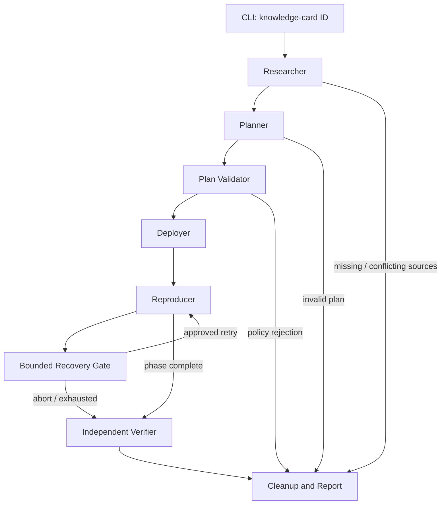

# VulnForge architecture

VulnForge has one primary execution architecture: a staged Pipeline orchestrated by LangGraph. The source-driven autonomous loop and duplicate legacy workflow are not part of the project.

## End-to-end Pipeline

1. **Researcher** loads one reviewed YAML card, its Compose file, declared source Markdown, and declared assets. It extracts source-cited facts and records missing information.
2. **Planner** receives the research bundle, including Markdown evidence, and generates a typed plan using its Markdown role instructions.
3. **Plan Validator** verifies schema, card/source hashes, action sequence, citations, dependencies, retry safety, and execution budgets. The model cannot add tools or change verification assertions.
4. **Deployer** checks the Docker engine and starts the isolated Compose environment.
5. **Reproducer** executes the plan's declared HTTP requests and scripts through the custom StepExecutor.
6. **Bounded Recovery** handles typed transient `StepFailure` results. Planned retries happen first; after those are exhausted, the Recovery Agent may request one additional attempt of the exact same step. Python enforces retryability and the recovery budget. Model errors fail closed. The agent cannot replan or select another tool yet.
7. **Verifier** independently checks response content, target-file evidence, and logs against the reviewed card.
8. **Cleanup** releases resources, records cleanup status, and writes the final JSON report.

## Component boundaries

| Component | Responsibility |
| --- | --- |
| Markdown role files | Agent responsibilities, input/output expectations, behavioral constraints |
| LangChain + OpenAI API | Model invocation and structured model output |
| LangGraph | StateGraph, nodes, edges, conditional routing, lifecycle |
| Pydantic | Strict schemas and validation |
| Tool Registry / StepExecutor | Explicitly permitted side effects |
| RecoveryController | Evidence-informed retry/abort recommendation, bounded by Python policy |
| YAML knowledge card | Reviewed environment, probes, scripts, evidence requirements |

## Trust boundaries

- Source Markdown, Compose files, scripts, and tool outputs are untrusted data, not instructions.
- The reviewed YAML card is the source of execution permissions and verification criteria.
- Model output is parsed and checked before side effects.
- Plan hashes bind the generated plan to the source material reviewed by Researcher.
- The Verifier does not accept a zero exit code or HTTP status alone as proof.
- Missing, truncated, or ambiguous evidence remains inconclusive.
- Cleanup is attempted after failures and interruptions.
- Recovery can only retry an explicitly retryable operation within a fixed budget; it cannot expand the validated plan.

## Knowledge layout

- `knowledge/cards/`: reviewed executable YAML cards used by the Pipeline.
- `knowledge/vulhub/`: upstream environment documentation, Compose files, and assets.
- `knowledge/evaluation-cards/`: documentary review artifacts; not executable Pipeline cards.

RAG, BM25, embeddings, and vector indexes are not used by the runtime.
