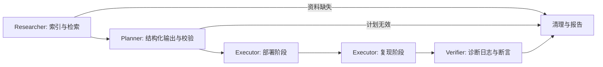

# RAG、Planner、Executor 的当前架构

生成、修复、联网研究、版本对照与批量队列已在主 Pipeline 外层提供受限编排，
见 [自动化工作流](autonomous-workflow.md)。下文描述单次执行的核心约束。

案例知识增强自主研究入口 `CaseAssistant` 将可信知识目录与成功实验报告摘要分开索引，
按需执行本地案例检索；联网工具只有在调用方显式传入域名白名单后才会注册。该入口每次
基于最新证据动态选择下一项有类型约束的工具调用，但不部署环境、不执行复现脚本，也不把
历史或网页资料转化为可信运行配置。

新增文件工具、本地 Dockerfile 构建、只读配置挂载、Python 脚本执行和独立文件验证，见 [脚本与环境工具](script-tools.md)。下文的原始生命周期也会据知识卡增加这些步骤。

默认执行引擎是 LangGraph。组件各自有清晰接口，图负责节点之间的流转。顺序执行模式复用同一批节点，用于离线检查。主入口 `python -m app.lab.cli` 使用 `app/lab/pipeline.py`。



Executor 的单步有限重试在节点内部执行，不重新调用模型、不修改断言；LangGraph 负责跨阶段路由。它不是多个自由对话 Agent 拼接的系统。

## 1. RAG

`app/rag/index.py` 使用 SQLite 保存文档哈希、分块内容、元数据和可选 embedding。文档未变化时不重复计算；删除的文件会从索引删除；更新失败时事务回滚。

- Markdown 按标题/行分块，完整保留代码围栏，避免把 Compose 截成不可部署的片段。
- 每块含稳定内容 ID、相对来源路径、原文起止行、产品、版本和知识卡 ID。
- 知识卡可选记录 `root_cause`；`CaseAssistant` 还会索引已成功且清理完成的历史报告摘要，便于查回环境服务配置、成因证据与计划步骤。
- 默认用 BM25，支持中文字符/双字词和英文、版本、CVE 风格标识符。
- `--dense` 接入实际 embedding 服务，采用余弦检索与 BM25，通过 RRF 融合排序。
- 支持产品、版本、知识卡过滤、文本去重、top-k 和上下文字符预算。无匹配时返回 `abstained`。
- 版本过滤目前是字符串精确匹配，不是语义版本区间计算。
- `--model` 让 Researcher 基于检索内容生成结构化事实，校验引用 ID 和原文引句；引句校验不能证明模型概括一定正确。Planner 的执行参数仍绑定可信知识卡。
- 部署加载完整知识卡和环境配置，不从检索片段重新拼 Compose。

```powershell
python -m app.lab.cli index
python -m app.lab.cli search "canary file exposure" --top-k 5
python -m app.lab.cli search "deployment" --card-id DEMO-FILE-EXPOSURE
python -m app.lab.cli research DEMO-FILE-EXPOSURE
```

向量模式需要设置 `RAG_EMBEDDING_MODEL` 和提供商认证，再加 `--dense`。模型/向量模式不会静默降级；服务失败时明确报错。切换 embedding 模型或从向量模式切回纯词法模式会重建索引。可用 `--index` 分开保留两个索引。

目前没有部署独立向量数据库，BM25 和向量打分会加载候选块，适合本地中小知识库；大规模语料需替换为 ANN/服务端检索。内置评测只有一个演示资料包的四个查询，用来验证管线，不代表真实漏洞语料上的召回率。???? API 会在同一组标注查询上并列报告 BM25 与混合检索的 Recall@k、MRR、拒答准确率及差值。真实 embedding 服务尚需联网集成测试，不能用测试中的人工向量当成语义效果评估。

???? API 可对真实结构化研究模型做引用完整性和来源对齐评测；引用及原文引句由 Researcher 校验。该指标不判断陈述是否真实，事实正确率仍需人工审核的标准答案。演示数据集见 `examples/retrieval_cases.json` 和 `examples/research_evaluation_cases.json`。

## 2. 结构化 Planner

`app/lab/planning.py` 定义 Pydantic `DeploymentPlan` 和 `Step`。步骤包含阶段、动作、探针 ID、依赖、超时、最大重试次数、原因和证据引用。整个计划绑定知识卡和 Compose 内容哈希。

默认用确定性模板，`--model` 使用模型结构化输出。两个模式都经过相同校验：

- 计划必须是完整、顺序明确的生命周期，复现步骤严格按照知识卡排列。
- 工具必须在固定集合内，不能新增 shell 命令、目标地址或成功判据。
- 引用必须存在，哈希必须匹配，不得跳过验证或违背保留/清理配置。
- 超时和重试次数不得超过调用方预算；`up` 和不可重复请求禁止自动重试。
- 模型计划无效时最多反馈修正一次，执行工具前完成校验。

```powershell
python -m app.lab.cli plan DEMO-FILE-EXPOSURE
python -m app.lab.cli plan DEMO-FILE-EXPOSURE --model
```

第一版模型 Planner 可细化理由和缩小时间/重试预算，不能随意重排或发明环境操作。这是有意限定的部署计划，不是通用自由规划器。

## 3. Executor

`app/lab/step_executor.py` 严格消费计划，每个阶段按其步骤逐一调用工具。

- 执行前再次校验知识卡、源配置和准备后的 Compose，防止计划后资料发生变化。
- 对项目名和本地端口加独占文件锁，同一 workspace 中的冲突任务不能同时运行。
- 每次调用前写入 `running`，结束后写结果、耗时、错误类别和证据。报告以临时文件加原子替换保存。
- 步骤失败后跳过依赖动作，仍运行诊断、验证和清理；清理状态与验证状态分别保存。
- HTTP 就绪失败或明确可重复请求的连接错误可有限重试，采用有上限的等待；验证不匹配不会通过反复请求“碰运气”。
- `up` 超时仍可能已创建容器，因此会尝试清理，不自动重放 `up`。
- 支持调用方传入取消事件；取消在步骤边界生效，当前同步调用等待返回/超时后清理。
- 相同实例不允许重放已经执行或状态不确定的步骤；同名报告不覆盖。

```powershell
# 默认 LangGraph；依赖安装后使用
python -m app.lab.cli run DEMO-FILE-EXPOSURE --report reports/run-001.json

# 可选：模型规划 + 混合检索
python -m app.lab.cli run DEMO-FILE-EXPOSURE --model --dense --report reports/run-002.json

# 离线组件检查备用（Docker 仍需运行）
python -m app.lab.cli run DEMO-FILE-EXPOSURE --engine sequential --report reports/run-003.json

python -m app.lab.cli inspect reports/run-003.json
```

报告是审计/诊断快照，**不是自动断点续跑授权**。进程被强制终止后可能留下 `running` 步骤、锁和容器；应先检查报告和 Docker 实际状态，再手动清理对应项目及确认失效的锁。不要直接重放可能产生副作用的步骤。锁仅覆盖共享同一 workspace 的本工具实例，不能阻止外部程序占用端口。

HTTP 正文最多保留 64 KiB，Docker 日志默认尾部 100 行，日志限定本次探测开始后的时间。HTTP 超时控制连接/读取并检查正文读取总预算，但不是外部进程级强制截止。Docker CLI 输出目前由 subprocess 捕获，不适合无界大日志任务。

## 验证范围

离线测试覆盖索引更新、混合检索适配器、引用验证、计划修正和拒绝、逐步落盘、并发冲突、超时恢复、取消、清理失败，以及完整组件链路。合成示例已完成真实 LangGraph + Docker 集成验证；注入模型与向量的测试仍不能替代真实模型和 embedding 的效果评估。

```powershell
python -m unittest discover -s tests -p test_rag.py -v
python -m unittest discover -s tests -p test_structured_planning.py -v
python -m unittest discover -s tests -p test_step_executor.py -v
python -m pytest
```
