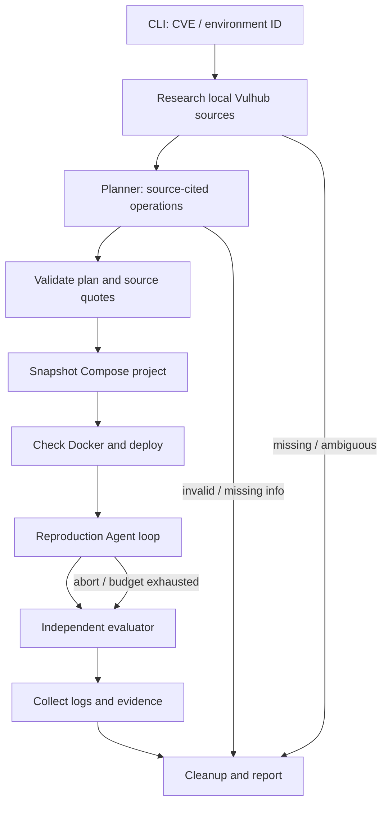

# VulnForge architecture

VulnForge keeps untrusted source material, trusted execution constraints, model
decisions, tool effects and verification evidence separate. The production runtime
does not use a retrieval index: it reads the selected local source files directly
and loads the trusted knowledge/evaluation card as structured data.

## Primary CLI path

The default CLI is implemented by `app/lab/vulhub_run.py`. It is a source-driven
agent loop, not the staged card-based `Pipeline` described later.

1. **Research**: `VulhubResearcher` finds one local environment and reads its
   Compose and Markdown files. Optional model synthesis cites exact source quotes.
2. **Planning**: the source planner creates typed HTTP/container operations. Each
   operation must reference an existing source path and exact quote. Operations
   must preserve readiness, initialization and reproduction ordering.
3. **Preparation**: the runner copies the selected environment into a per-run
   workspace, rewrites published ports to loopback and rejects unsafe Compose
   properties such as host networking and symlink escapes.
4. **Deployment**: Docker Compose starts the isolated project and waits for readiness.
5. **Reproduction**: a bounded LangGraph loop chooses one next action at a time
   from typed operations, source reads and log inspection. Tool results are fed
   back as observations. The agent cannot directly execute arbitrary host commands.
6. **Evaluation**: finishing submits the attempt; a separate evaluator reads the
   reviewed evaluation card and checks observed request structure, response/file
   evidence and logs. The agent's finish decision is not success.
7. **Cleanup**: logs are collected and Compose resources are removed unless
   `--keep` is set. The JSON report and trace preserve the outcome.

## Card-based staged Pipeline API

`app/lab/pipeline.py` is a second, reusable staged workflow. It has explicit
Researcher, Planner, Deployer, Reproducer, Verifier and Cleanup nodes, with LangGraph
conditional routing or a sequential engine. Its Researcher loads a typed YAML card,
the complete Compose configuration and declared assets directly. The planner's
lifecycle is constrained by that card; it cannot add actions or verification
assertions. The executor re-checks source hashes before side effects.

This API is used by some higher-level authoring/recovery/comparison components.
It should not be confused with the primary CLI's dynamic source-driven reproduction
loop.

## Trust boundaries and safety controls

- Vulhub Markdown, Compose files, web pages and tool outputs are untrusted data,
  never instructions that override system policy.
- YAML cards and evaluation cards are reviewed inputs. They define allowed services,
  ports, requests, scripts and expected evidence.
- Model output is parsed into Pydantic schemas and validated before tool execution.
- HTTP requests are constrained to local published ports. Container commands are
  argument arrays and run inside declared Compose services.
- The evaluator does not accept a zero exit code or HTTP status alone as proof.
  Missing, truncated or ambiguous evidence should remain inconclusive.
- Cleanup is attempted after failures and interruptions; reports distinguish
  reproduction status from cleanup status.

## Retrieval experiments are separate

`app/rag/` and the embedding experiment scripts are not imported by the primary
CLI or the card-based core Pipeline. They remain optional research code for
comparing lexical/dense retrieval approaches. Removing them from the production
runtime does not remove the trusted YAML knowledge cards, source documents, or
direct local source-reading tools.
